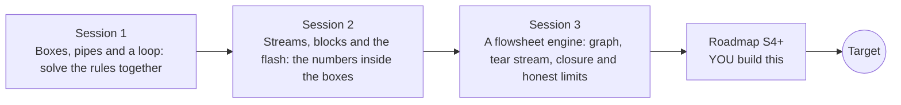

# openprocesssim

[](https://github.com/KrunalPanchal1995/openprocesssim/actions/workflows/ci.yml)   [](https://colab.research.google.com/github/KrunalPanchal1995/openprocesssim/blob/main/sessions/session-01/lesson.ipynb) [](https://krunalpanchal1995.github.io/openprocesssim/)

**Build a small open process simulator: boxes, streams, a flash and a recycle loop, in three sessions.**

openprocesssim teaches how a flowsheet program works inside: streams, unit blocks, a vapour-liquid flash and the tear-stream trick that closes a recycle loop, using only Python and a browser.

- **Start from zero.** Session 1 needs one fraction and a three-line linear system; every symbol is explained.
- **See the loop close.** Each session ships a slider app; Session 3 shows the pipe widths and the recycle iteration converging.
- **Know you got it right.** Each session ends with a checkpoint that prints PASS or FAIL against hand calculations and balance closure.
- **Build the missing half.** The repo stops at Session 3 on purpose; the roadmap shows the path to the Target.

[Target](#the-target) · [Who is this for](#who-is-this-for) · [Quick start](#quick-start) · [Sessions](#sessions) · [Roadmap](#roadmap) · [Contribute](#contribute) · [Explainer PDF](docs/explainer.pdf)

> **This repo is incomplete on purpose.** Sessions 1 to 3 are here and fully working. The finished Target below is a preview of what the community can build next. We show you the path, not the code. Sessions 4 and up are yours.

## The Target

A flowsheet drawn as boxes (mixer, reactor, flash, splitter) whose pipes are as wide as the molar flow they carry. First the recycle stream is guessed and corrected round after round, and you watch the pipes settle while a plot shows the error of three solvers falling: plain substitution slowly, Wegstein faster, and a Newton polish in a few steps. Then the flash temperature is swept up and down: the loop is re-solved in every frame, the vapour pipe widens, and a marker slides down the purity curve past the 0.70 target. A second picture maps the operating window of flash temperature and recycle fraction where both purity and product flow are met. Your goal over the coming sessions: build that picture yourself.


*Target: flowsheet pipes sized by flow, recycle iteration converging, purity against flash temperature*


*Target frame: the converged loop at a flash temperature of 367.9 K, with the convergence of three solvers*


*Operating window: flash temperature and recycle fraction that meet both purity and product flow*

Try it live:

- [Math Visual Studio: interactive maths playground](https://krunalpanchal1995.github.io/studio/)

How the Target was made is shown only as a path in [promo/roadmap.md](promo/roadmap.md).

## Who is this for
**diploma / undergraduate to advanced undergraduate (levels 5-6).** Topic area: Chemical, Environmental and Process Engineering.

Prerequisites:

- Fractions, logarithms and the idea of a mole (school level); mass balances are in openmassbalance, heat exchangers in openheatexchanger, reactors in openreactor and flash and distillation ideas in opendistillation.
- Python 3.10 or newer; if `python --version` works, you are ready. PRIMER.md explains the rest.
- No prior GitHub or chemical-engineering experience is needed.

New to Python? Read [PRIMER.md](PRIMER.md) first (10 minutes).

## Quick start

No installation knowledge needed. You need [Git](https://git-scm.com/downloads) and [Python 3.10+](https://www.python.org/downloads/) (Windows: tick "Add Python to PATH"). On Mac and Linux type `python3` wherever this page says `python`.

```bash
git clone https://github.com/KrunalPanchal1995/openprocesssim.git
cd openprocesssim
python start.py 1
```

`start.py` creates a private environment, installs what is needed and runs Session 1 with its checkpoint. Next: `python start.py 2`, `python start.py 3`, or `python start.py test` to check everything. Only a checkpoint: `python start.py check 1`.

Three lines solve a recycle loop from Session 1 (they work as they are): Save it as `try.py` and run it with `python start.py run try.py` (this uses the private environment, where NumPy is installed):

```python
import numpy as np
A = np.array([[1, 0, -1], [-0.6, 0, 1], [-0.4, 1, 0]])   # mixer and separator rules, recycle fraction 0.6
print(np.linalg.solve(A, [100, 0, 0]))                    # S, P, R -> [250. 100. 150.]
```

Every session also opens in your browser with sliders (no install): [live apps](https://krunalpanchal1995.github.io/openprocesssim/). Or use the Colab badge above for the notebook.

## Sessions

| # | Session | Model level | Time | Live app |
|---|---|---|---|---|
| 1 | [Boxes, pipes and a loop: solve the rules together](sessions/session-01/README.md) | Level 1: conceptual interactive model | 60 min | [open](https://krunalpanchal1995.github.io/openprocesssim/session-01/) |
| 2 | [Streams, blocks and the flash: the numbers inside the boxes](sessions/session-02/README.md) | Level 2: mathematical engineering model | 80 min | [open](https://krunalpanchal1995.github.io/openprocesssim/session-02/) |
| 3 | [A flowsheet engine: graph, tear stream, closure and honest limits](sessions/session-03/README.md) | Level 3: simulation and validation | 90 min | [open](https://krunalpanchal1995.github.io/openprocesssim/session-03/) |

Each session follows the same six steps: A real-world problem, B concept and theory, C visual explanation, D interactive simulation, E worked example and experiment, F assessment and design challenge. Each ends with `checkpoint.py`, which prints `PASS` or `FAIL` against reference numbers. Session 3 also contains the real-world mini-project: **Design a benzene recovery loop**.

## Architecture



| Folder or file | What is inside |
|---|---|
| `sessions/` | three sessions: README (A-F), `lesson.py`, notebook, live app, exercises, activity sheet, checkpoint |
| `promo/` | the Target: media, live links, and the roadmap (path only) |
| `docs/` | `explainer.tex` and the built `explainer.pdf` |
| `tests/` | runs every lesson and checkpoint headless |
| `start.py` | one command to set up and run anything |
| `QUALITY.md`, `RUBRIC.md` | the quality checklist and the scoring rubric |
| `.github/` | CI, PDF build, Pages deploy, issue and PR templates |

## Roadmap

| Milestone | What you will build | Difficulty |
|---|---|---|
| Session 4: Equation-oriented solving with Newton | A Newton solver for the tear stream of the mini-project loop, with a damped step. | intermediate |
| Session 5: Non-ideal activity models | Replace K = P_sat / P with K = gamma P_sat / P using a simple two-parameter model. | advanced |
| Session 6: A rigorous distillation column | A column block with N stages, reflux ratio and a feed stage. | advanced |
| Session 7: A graphical flowsheet editor | Save a flowsheet as JSON from a drawing, load it into the engine and solve it. | intermediate |
| Session 8: A property package | A data file and loader, with water added as a fourth component. | intermediate |

Full detail with a checkpoint per milestone: [promo/roadmap.md](promo/roadmap.md).

## Contribute
New to GitHub? Read [CONTRIBUTING.md](CONTRIBUTING.md); it starts from zero. Pick an issue labelled `good first issue`. Translations into Hindi, Telugu, Tamil and Malayalam are welcome.

<details>
<summary>Development</summary>

```bash
python start.py test        # runs every lesson and checkpoint
```
Lessons use `# %%` cell markers so they open as notebooks in VS Code. See [QUALITY.md](QUALITY.md) for the standard every session meets.
</details>

## License
MIT. See [LICENSE](LICENSE). Media in `promo/media` is (c) Krunal Panchal, CC BY 4.0.

## Acknowledgments
Part of the [PAN IIT OSS](https://hellofoss.tech-iitb.org/projects) open-source teaching collection, modelled on the structure of [openspline](https://github.com/openspline/openspline). Built on ideas from the Math Visual Studio at https://krunalpanchal1995.github.io/studio/.
