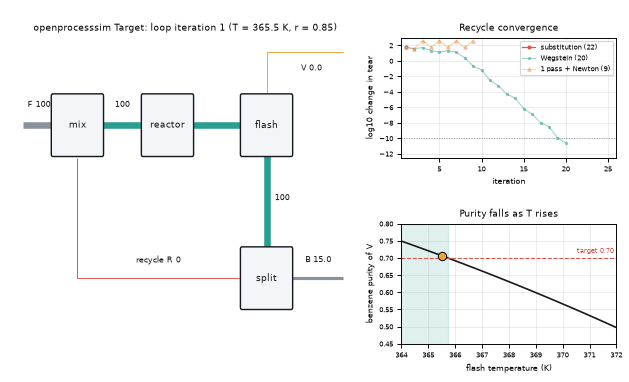
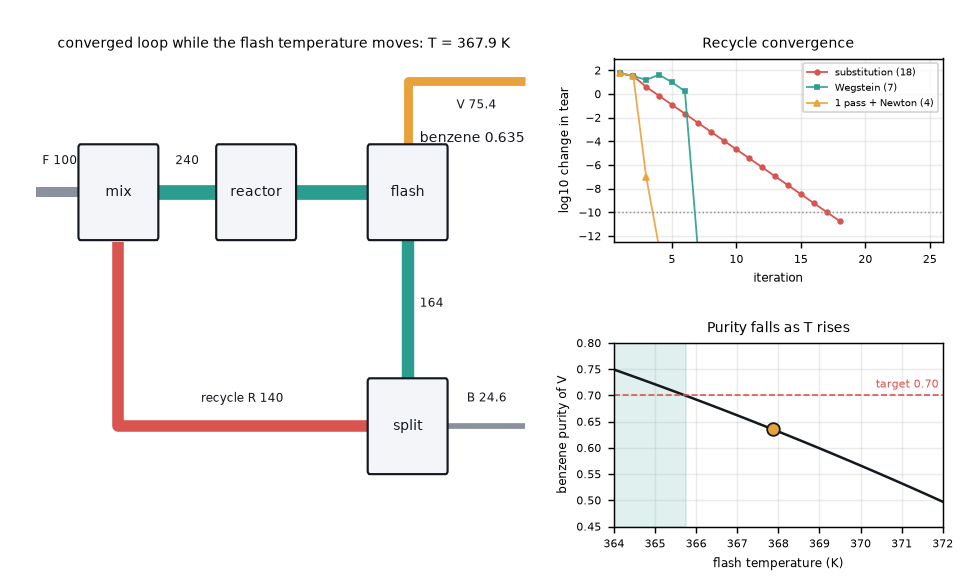
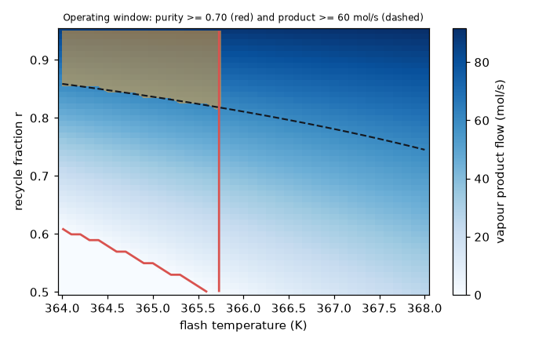

# What you are building toward

A flowsheet drawn as boxes (mixer, reactor, flash, splitter) whose pipes are as wide as the molar flow they carry. First the recycle stream is guessed and corrected round after round, and you watch the pipes settle while a plot shows the error of three solvers falling: plain substitution slowly, Wegstein faster, and a Newton polish in a few steps. Then the flash temperature is swept up and down: the loop is re-solved in every frame, the vapour pipe widens, and a marker slides down the purity curve past the 0.70 target. A second picture maps the operating window of flash temperature and recycle fraction where both purity and product flow are met. Your goal over the coming sessions: build that picture yourself.

*Target: flowsheet pipes sized by flow, recycle iteration converging, purity against flash temperature*

*Target frame: the converged loop at a flash temperature of 367.9 K, with the convergence of three solvers*

*Operating window: flash temperature and recycle fraction that meet both purity and product flow*

These results come from a private reference build. The code is not published; the roadmap shows the path so you can build your own.

Live links:

- [Math Visual Studio: interactive maths playground](https://krunalpanchal1995.github.io/studio/)
