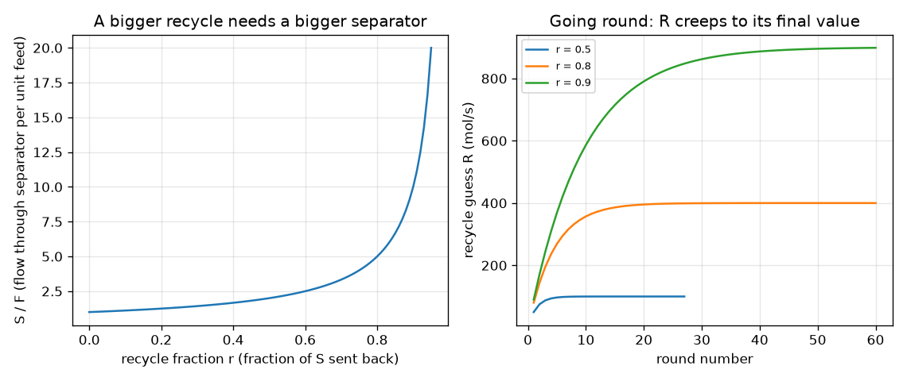

# Session 1: Boxes, pipes and a loop: solve the rules together

*Level 1 (conceptual interactive model) · about 60 minutes · openprocesssim*

> This is a simplified educational model. It is not a validated design tool and must not be used for real structures, electrical installations, vehicles, industrial processes or medical decisions.

**Prerequisites**

- Fractions and what a flow rate is.
- You have read PRIMER.md and run `python start.py 1` once.

**Learning objectives.** After this session you can:

- Describe a plant as boxes joined by pipes, where each box has inlets, outlets and a rule.
- Write each box rule as one equation and solve all equations together with a matrix.
- Solve the same loop by guessing the recycle and going round (successive substitution).
- Explain why a bigger recycle fraction needs a much bigger separator.

## A. Real-world problem
In a chemical plant a stream of liquid goes into a separator. The good part leaves as product and the rest is sent back to the start to try again. Every box obeys a simple rule (what goes in comes out), but because of the loop the flow into the first box depends on the flow out of the last. How much liquid really passes through the separator, and how does that change if we send more back? Flowsheet programs answer this for plants with hundreds of boxes; this repo builds a learning-scale analogue in the spirit of commercial flowsheet tools. Session 1 uses one number per pipe, a total flow in mol/s. It is a teaching model: real plants need process-safety engineering.

## B. Concept and theory
A flowsheet is a graph: boxes are the nodes and pipes (streams) are the lines between them. Name the streams: F = fresh feed (known), S = flow into the separator, P = product, R = recycle. Each box gives equations. The mixer joins F and R, so S = F + R. The separator sends a fraction r of S back and the rest out: R = r S and P = (1 - r) S. That is 3 unknowns (S, P, R) and 3 equations, so the plant can be solved. Written as a matrix, A x = b with x = [S, P, R], the computer solves all rules together in one step. The other way is to guess R, run the mixer and separator in order to get a new R, and repeat until the guess stops changing: successive substitution. For this loop the answer is S = F / (1 - r): at r = 0.5 the separator handles 2 times the feed, at r = 0.8 it handles 5 times and at r = 0.95 it handles 20 times.

| Symbol | Meaning | Unit |
|---|---|---|
| F | fresh feed flow (known) | mol/s |
| S | flow into the separator | mol/s |
| P | product flow | mol/s |
| R | recycle flow | mol/s |
| r | recycle fraction, share of S sent back (0 to below 1) | no unit |

**Assumptions**

- Steady state: nothing changes with time.
- One number per pipe (total molar flow); no composition, temperature or chemistry yet.
- The mixer and separator lose nothing: what goes in comes out.
- The recycle fraction is below 1, otherwise nothing could leave.

$$ S = F + R $$

$$ R = r\,S,\qquad P = (1-r)\,S $$

$$ \begin{pmatrix}1&0&-1\\-r&0&1\\-(1-r)&1&0\end{pmatrix}\begin{pmatrix}S\\P\\R\end{pmatrix}=\begin{pmatrix}F\\0\\0\end{pmatrix}\ \Rightarrow\ S=\frac{F}{1-r} $$

## C. Visual explanation
The left figure plots S / F against the recycle fraction r: it starts at 1 for r = 0 (no recycle), is 2 at r = 0.5, 5 at r = 0.8 and 20 at r = 0.95, rising ever more steeply. The right figure shows the guess-and-go-round method: for each r the recycle guess R climbs towards its final value (100 mol/s at r = 0.5, 400 mol/s at r = 0.8, 900 mol/s at r = 0.9) and needs more rounds the closer r is to 1.

*Left: separator flow per unit feed against the recycle fraction. Right: guess-and-go-round recycle guesses for r = 0.5, 0.8 and 0.9.*

## D. Interactive simulation
Run the lesson (`python start.py 1`), then open the live app: [Session 1: boxes, pipes and a loop](https://krunalpanchal1995.github.io/openprocesssim/session-01/) (or `app.html` in this folder). Move the recycle fraction and the feed and watch the pipe widths in the plant picture. Then open the graph and see the red dot slide up the curve. Read the number of rounds that guess-and-go-round needs.

**Challenge.** Make the separator handle at least 400 mol/s while the fresh feed stays at or below 100 mol/s.

## E. Worked example and experiment
**Problem.** A plant has a fresh feed F = 100 mol/s and a recycle fraction r = 0.6. Find S, R and P, and show the first three rounds of the guess-and-go-round method starting from R = 0.

1. Mixer: S = F + R. Separator: R = 0.6 S and P = 0.4 S.
2. Substitute: S = 100 + 0.6 S, so 0.4 S = 100 and S = 250 mol/s.
3. Then R = 0.6 * 250 = 150 mol/s and P = 0.4 * 250 = 100 mol/s. Check: the product equals the fresh feed (100 = 100), as the overall balance demands.
4. Go round: guess R = 0, then S = 100 and the new R = 60. Next S = 160 and R = 96. Next S = 196 and R = 117.6. The guesses climb towards 150 and the code needs 37 rounds to get within 1e-6.

**Answer.** S = 250 mol/s, R = 150 mol/s, P = 100 mol/s; the guesses go 60, 96, 117.6 and so on towards 150.

**Experiment.** With a small water pump, a jug and a Y-shaped splitter fitting, build a loop in which a fraction of the pump flow is sent back to the jug, and measure the flows with a measuring cup and a stopwatch. Compare the flow in the loop with F / (1 - r). The model and reality differ because pump flow depends on back-pressure, the split fraction is set by the valve and changes with flow, and the tank level is not constant.

## F. Assessment and design challenge
**Question type A: Conceptual.** Why is the product flow equal to the fresh feed even though the separator handles much more?

Hint

Draw a box around the whole plant and count only what crosses the box.

Step-by-step solution

At steady state nothing accumulates, so what enters the plant must leave it. Only the fresh feed crosses the plant boundary on the way in and only the product on the way out; the recycle stays inside. So P = F, however large S and R become.

**Question type B: Numerical.** Find S, R and P for F = 100 mol/s and r = 0.75.

Hint

S = F / (1 - r), then R = r S and P = (1 - r) S.

Step-by-step solution

S = 100 / 0.25 = 400 mol/s, R = 0.75 * 400 = 300 mol/s, P = 0.25 * 400 = 100 mol/s. Units: mol/s throughout. Sanity check: P = F and S = F + R (400 = 100 + 300).

**Question type C: Graph and simulation interpretation.** On the left figure, what does the separator handle per unit feed at r = 0.8 and at r = 0.95, and what does that mean for equipment size?

Hint

Read S / F off the curve.

Step-by-step solution

At r = 0.8 it handles 5 times the feed and at r = 0.95 it handles 20 times. Equipment is sized for S, not for F, so going from r = 0.8 to 0.95 makes the separator four times bigger for the same product.

**Question type D: Design and optimisation challenge.** Design: the separator can pass at most 400 mol/s. What is the largest recycle fraction at a feed of 100 mol/s, and what happens if the feed is raised to 150 mol/s? What would you trade away?

Hint

r = 1 - F / S_max.

Step-by-step solution

r = 1 - 100 / 400 = 0.75 at 100 mol/s. At 150 mol/s the largest is r = 1 - 150 / 400 = 0.625 (check: S = 150 / 0.375 = 400). A lower recycle fraction means less of the 'not good enough' material gets a second chance, so in a real plant product quality or yield falls unless the separator is enlarged. This toy has no separation quality yet; Sessions 2 and 3 add it.

Score yourself with [RUBRIC.md](../../RUBRIC.md). Print the [activity sheet](activity_sheet.md) to work on paper.

## Common misconceptions
| Common misconception | What is actually true |
|---|---|
| A recycle adds product. | The product equals the fresh feed at steady state. A recycle only gives material further chances; it makes the equipment handle more flow. |
| Going round once is enough to solve a loop. | One round gives only the first guess (60 mol/s in the worked example, true value 150). It takes 37 rounds to reach 1e-6, and 175 rounds at r = 0.9. |
| A bigger recycle fraction costs a little more. | S = F / (1 - r) blows up as r approaches 1: 5 times the feed at 0.8, 20 times at 0.95. |
| A recycle fraction of 1 is the best recycle. | With r = 1 nothing can leave, so the equations have no solution; the code refuses it. |

## Glossary
- **stream**: a pipe, with the flow it carries
- **box (unit)**: a piece of equipment with inlets, outlets and a rule
- **recycle**: a stream sent back to an earlier box
- **steady state**: nothing changes with time
- **successive substitution**: guess, run the boxes, take the result as the next guess, repeat
- **matrix equation**: all box rules written as A x = b and solved together

## Finish
1. Do the three coding tasks in [exercises.md](exercises.md).
2. Run `python start.py 1` again after your changes. It ends with the checkpoint; when it prints `PASS`, you are done. (Checkpoint only: `python start.py check 1`.)

Next: [Session 2](../session-02/README.md)
