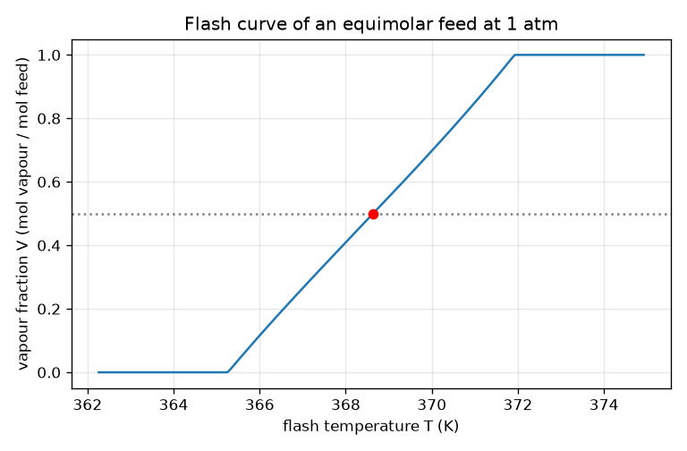
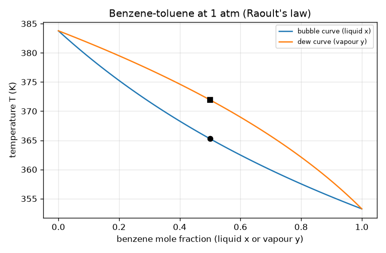

# Session 2: Streams, blocks and the flash: the numbers inside the boxes

*Level 2 (mathematical engineering model) · about 80 minutes · openprocesssim*

> This is a simplified educational model. It is not a validated design tool and must not be used for real structures, electrical installations, vehicles, industrial processes or medical decisions.

**Prerequisites**

- Session 1: boxes, pipes, loops.
- Logarithms and powers of 10; the idea of finding a root by bisection.

**Learning objectives.** After this session you can:

- Define a stream object (component flows, T, P, phase) and write mixer, splitter, heater, pump and valve as functions.
- Compute vapour pressures with the Antoine equation and K-values with Raoult's law.
- Find bubble and dew points by root-finding and check them against the boiling points of pure liquids.
- Solve the Rachford-Rice equation for the vapour fraction, check mass balance closure and the limits V = 0 and V = 1, and solve a design problem for the flash temperature.

## A. Real-world problem
A liquid mixture of benzene and toluene is heated until it just starts to boil, then a little more. Part of it turns into vapour, which is richer in the more volatile benzene. At what temperature does it start to boil, and how much vapour do we get at a chosen temperature? Inside a flowsheet program this question is answered thousands of times per solve; today you write that box. This is a teaching model with ideal liquids and gases and rounded textbook constants, not a design tool; benzene is also a hazardous chemical, and this repo only computes with it.

## B. Concept and theory
A stream carries the molar flow n_i of each component (mol/s), a temperature T, a pressure P and a phase tag. With a constant liquid heat capacity Cp_i, enthalpy relative to the pure liquids at 298.15 K is H = sum n_i Cp_i (T - 298.15), plus n_i times the heat of vaporisation if the stream is vapour. The Antoine equation, log10(P_sat / mmHg) = A - B / (C + T / degC), gives the vapour pressure of each pure liquid (rounded textbook constants for benzene, toluene and ethanol are in the lesson; 1 mmHg = 0.1333224 kPa). Raoult's law for an ideal mixture says the partial pressure of i is x_i P_sat_i, so y_i = K_i x_i with K_i = P_sat_i / P. The bubble point is where sum x_i P_sat_i = P, and the dew point is where sum y_i / K_i = 1; both are found by bisection on T. For a flash of a feed z at given T and P, the component balance z_i = V y_i + (1 - V) x_i and the requirement that the vapour fractions add up to 1 give the Rachford-Rice equation f(V) = sum z_i (K_i - 1) / (1 + V (K_i - 1)) = 0. f falls as V rises, so there is one root between 0 and 1, found by bisection or by Newton's method. For a given feed, a mixture boils over a window between its bubble and dew points; V is 0 at the bubble point and 1 at the dew point.

| Symbol | Meaning | Unit |
|---|---|---|
| n_i | molar flow of component i | mol/s |
| z_i, x_i, y_i | mole fraction in feed, liquid, vapour | no unit |
| T, P | temperature and pressure | K, kPa |
| P_sat_i | vapour pressure of pure i | kPa |
| K_i | K-value, y_i / x_i = P_sat_i / P | no unit |
| V | vapour fraction, mol vapour per mol feed | no unit |
| Cp_i | liquid heat capacity | J/(mol K) |
| H | enthalpy flow | W |

**Assumptions**

- Ideal liquid mixture (Raoult's law) and ideal vapour.
- Constant heat capacities and heats of vaporisation (approximate values).
- Antoine constants are rounded textbook values for roughly 10 to 100 degrees C.
- No pressure drop inside blocks; the pump ignores its temperature rise.

$$ \log_{10}\frac{P^{sat}_i}{\mathrm{mmHg}}=A_i-\frac{B_i}{C_i+T/{}^\circ\mathrm{C}},\qquad K_i=\frac{P^{sat}_i}{P} $$

$$ \text{bubble: }\sum_i x_iP^{sat}_i(T)=P,\qquad \text{dew: }\sum_i \frac{y_i}{K_i}=1 $$

$$ f(V)=\sum_i\frac{z_i(K_i-1)}{1+V(K_i-1)}=0,\qquad x_i=\frac{z_i}{1+V(K_i-1)},\quad y_i=K_ix_i $$

$$ H=\sum_i n_i\,Cp_i\,(T-298.15)\ \ (+\,n_i\Delta H^{vap}_i\text{ for vapour}) $$

## C. Visual explanation
The first figure is the T-x-y diagram of benzene and toluene at 1 atm: the bubble curve (liquid) lies below the dew curve (vapour). For the equimolar mixture (marked) the bubble point is 365.3 K and the dew point 371.9 K, so the mixture boils over a window 6.7 K wide. The second figure is the flash curve of that feed: the vapour fraction rises from 0 at the bubble point to 1 at the dew point and passes 0.5 at 368.6 K (the red dot).

*Vapour fraction against flash temperature for the equimolar feed; the red dot is the 50 percent design point.*

*T-x-y diagram of benzene-toluene at 1 atm (Raoult's law); the markers show the bubble and dew points of the equimolar feed.*

## D. Interactive simulation
Run the lesson (`python start.py 2`), then open the live app: [Session 2: a flash drum](https://krunalpanchal1995.github.io/openprocesssim/session-02/) (or `app.html` in this folder). Pick the benzene fraction of the feed, the flash temperature and the pressure. Watch the drum fill with liquid or vapour, the point on the T-x-y diagram move between the curves, and the flash curve. Raise the pressure and see the boiling window move up.

**Challenge.** Find settings where at least 30 percent of the feed vaporises and the vapour is at least 0.8 benzene.

## E. Worked example and experiment
**Problem.** An equimolar benzene-toluene feed (z = 0.5 each) at 1 atm (101.325 kPa) is flashed at 368 K. Find K-values, V, and the liquid and vapour compositions.

1. Antoine at 368 K: P_sat is 156.2 kPa for benzene and 63.3 kPa for toluene.
2. K = P_sat / P: K_benzene = 156.2 / 101.325 = 1.542 and K_toluene = 63.3 / 101.325 = 0.6245.
3. Rachford-Rice: f(V) = 0.5 * 0.542 / (1 + 0.542 V) + 0.5 * (-0.3755) / (1 - 0.3755 V) = 0. Both ends of the interval are tested: f(0) is positive and f(1) is negative, so V is between 0 and 1. Bisection gives V = 0.409 (Newton's method needs 4 iterations, bisection 40 to reach 1e-12).
4. Liquid: x_benzene = 0.5 / (1 + 0.409 * 0.542) = 0.409. Vapour: y_benzene = 1.542 * 0.409 = 0.631.

**Answer.** K = 1.542 and 0.6245, V = 0.409, liquid 0.409 benzene, vapour 0.631 benzene.

**Experiment.** In a supervised teaching lab, heat a mixture of two low-hazard liquids (not benzene) in a small flask with a condenser and thermometer, record the temperature at which boiling starts, and collect a few drops of the first condensate. Compare the boiling start with the bubble point and the condensate composition with y. The model and reality differ because real mixtures are not ideal, the Antoine constants are approximate, the flask is not at exactly 1 atm, and condensate composition changes as boiling proceeds.

## F. Assessment and design challenge
**Question type A: Conceptual.** Why can a mixture not boil at a single temperature, as a pure liquid does?

Hint

Compare the bubble and dew curves at the same composition.

Step-by-step solution

The more volatile component leaves first, so the liquid left behind becomes richer in the heavy component and its boiling temperature rises. The first vapour appears at the bubble point and the last liquid disappears at the dew point; between them both phases coexist. For the equimolar benzene-toluene mixture this window is 6.7 K wide.

**Question type B: Numerical.** (a) How much heat does heating 100 mol/s of the equimolar liquid from 300 K to 350 K take? (b) What shaft power does a pump with 70 percent efficiency need to raise it by 400 kPa (molar volume 1e-4 m3/mol)? (c) What is the temperature after mixing 60 mol/s benzene at 300 K with 40 mol/s toluene at 340 K?

Hint

(a) Q = sum n Cp dT. (b) W = n v dP / eta. (c) Energy balance with the Cp values.

Step-by-step solution

(a) Cp mix = 0.5 * 136 + 0.5 * 157 = 146.5 J/(mol K), so Q = 100 * 146.5 * 50 = 732.5 kW. (b) W = 100 * 1e-4 * 400 000 / 0.7 = 5714 W = 5.71 kW. (c) T = 298.15 + (60 * 136 * 1.85 + 40 * 157 * 41.85) / (60 * 136 + 40 * 157) = 317.4 K. Units: W, W, K. Sanity checks: the mixed temperature lies between 300 and 340 K, and closer to 300 K because benzene is the larger flow.

**Question type C: Graph and simulation interpretation.** From the flash curve and T-x-y diagram: what is the highest benzene fraction any single flash of the equimolar feed can give in the vapour, and what temperature gives 50 percent vapour?

Hint

The purest vapour is the very first vapour at the bubble point.

Step-by-step solution

The first vapour at the bubble point has 0.714 benzene and no flash of this feed can do better; as V grows the vapour gets leaner. 50 percent vapour needs 368.6 K, and then the vapour is 0.611 benzene and the liquid 0.389. A single flash cannot make a pure product, which is why columns and recycles exist.

**Question type D: Design and optimisation challenge.** Design: a flash of the equimolar feed at 1 atm must vaporise at least 30 percent of the feed and give a vapour with at least 0.65 benzene. Find the temperature window and say what a control engineer would worry about.

Hint

V >= 0.3 needs T >= 367.2 K. Purity falls as T rises; find where y drops below 0.65.

Step-by-step solution

30 percent vapour needs 367.2 K, at which y = 0.655. The purity stays at or above 0.65 only up to 367.39 K (and is below 0.65 at 367.45 K). The window is only about 0.15 K wide, so the temperature controller must hold the flash to a fraction of a degree. In practice the target would be relaxed or a different pressure or an extra stage chosen. Assumptions: ideal mixture and approximate constants, so the true window will differ.

Score yourself with [RUBRIC.md](../../RUBRIC.md). Print the [activity sheet](activity_sheet.md) to work on paper.

## Common misconceptions
| Common misconception | What is actually true |
|---|---|
| The vapour has the same composition as the liquid. | The vapour is richer in the more volatile component: at 368 K the liquid is 0.409 benzene and the vapour 0.631. |
| The K-value of a component depends on how much of it is present. | In an ideal mixture K = P_sat(T) / P depends only on T and P. Composition enters through x and y. |
| If I increase temperature, the vapour gets purer. | Hotter means more vapour but leaner in benzene: purity falls from 0.714 at the bubble point towards the feed value at the dew point. |
| The flash equation always has a root between 0 and 1. | Only if the feed is two-phase. Below the bubble point f(0) is not positive and V = 0; above the dew point V = 1 (at 340 K the feed is all liquid, at 400 K all vapour). |

## Glossary
- **Antoine equation**: a fit that gives the vapour pressure of a pure liquid from temperature
- **Raoult's law**: for an ideal mixture the partial pressure of a component is its mole fraction times its pure vapour pressure
- **K-value**: ratio y / x of a component between vapour and liquid
- **bubble point**: temperature at which a liquid mixture first boils
- **dew point**: temperature at which a vapour mixture first condenses
- **flash**: a single equilibrium split of a feed into vapour and liquid
- **Rachford-Rice equation**: the equation in V that makes liquid and vapour mole fractions add to 1
- **duty**: heat added to (or removed from) a block, in W

## Finish
1. Do the three coding tasks in [exercises.md](exercises.md).
2. Run `python start.py 2` again after your changes. It ends with the checkpoint; when it prints `PASS`, you are done. (Checkpoint only: `python start.py check 2`.)

Next: [Session 3](../session-03/README.md)
