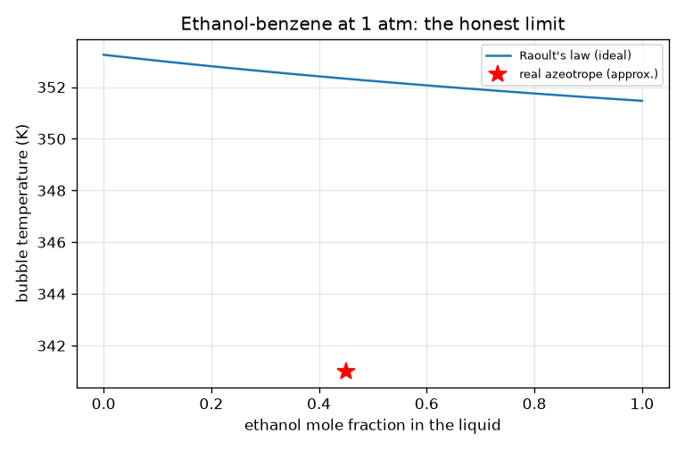
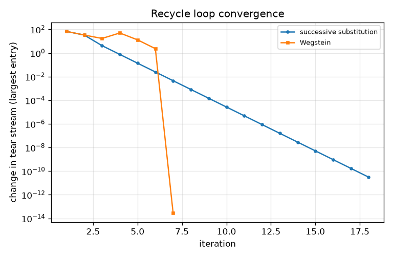
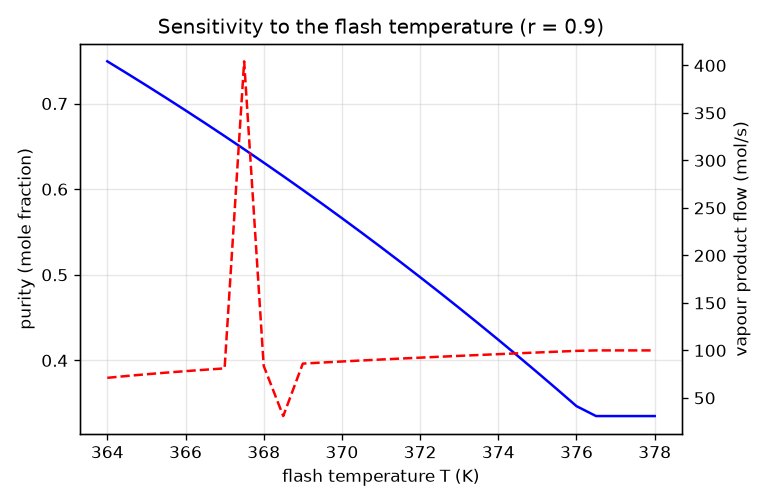

# Session 3: A flowsheet engine: graph, tear stream, closure and honest limits

*Level 3 (simulation and validation) · about 90 minutes · openprocesssim*

> This is a simplified educational model. It is not a validated design tool and must not be used for real structures, electrical installations, vehicles, industrial processes or medical decisions.

**Prerequisites**

- Sessions 1 and 2: loops, streams, the flash.
- Reading a Python dictionary and a list of dictionaries.

**Learning objectives.** After this session you can:

- Represent a flowsheet as a graph of blocks and streams, find a run order and a tear stream.
- Solve a recycle loop by successive substitution and by Wegstein acceleration and compare iteration counts.
- Refuse an under- or over-specified flowsheet with a clear degrees-of-freedom message, and report mass and energy closure.
- Run a sensitivity study, and recognise two honest limits: a recycle that cannot converge, and a non-ideal mixture where Raoult's law fails.

## A. Real-world problem
A plant feeds mostly toluene. A reactor turns part of it into benzene, a flash separates a benzene-rich vapour, and the toluene-rich liquid is partly sent back to the start. A loop like that cannot be solved box by box in one pass, because the input of the first box depends on the output of the last. Commercial flowsheet tools solve this with a tear stream; here you build a small version of that engine. The reaction is a toy (toluene turning into benzene mole for mole, with no heat of reaction), the thermodynamics is ideal, and the result must never be used for plant design or safety decisions.

## B. Concept and theory
A flowsheet is a graph: blocks are nodes and streams are directed edges from the block that makes them to the block that uses them. If the graph has no loop, sort the blocks so that every block runs after the blocks that feed it (a topological order). If it has a loop, choose a tear stream: a stream whose removal leaves no loop. Guess the tear stream, run the blocks in order, and read the tear stream that comes back. Successive substitution uses what came back as the next guess. Wegstein acceleration estimates the slope s = (g_k - g_{k-1}) / (x_k - x_{k-1}) of the returned value g against the guess x and sets x_next = q x + (1 - q) g with q = s / (s - 1), limited to -5 <= q <= 0. The blocks here are: mixer (adiabatic, outlet temperature from an energy balance), splitter (fraction r to the first outlet), conversion reactor (a fraction X of the toluene entering becomes benzene), heat exchanger (outlet temperature given, or UA with a utility at constant temperature T_u, giving T_out = T_u - (T_u - T_in) exp(-UA / (n Cp)) and duty Q = n Cp (T_out - T_in)) and the isothermal flash of Session 2. Before solving, degrees of freedom are counted: DOF = settings given minus settings needed. DOF below 0 means under-specified, above 0 over-specified; the engine refuses both and says where. After solving, the engine reports mass closure (for each component, feed plus generation by reaction minus products out) and energy closure (enthalpy of products minus feeds minus the sum of block duties). A binary mixture in two phases at fixed T and P has no freedom left (phase rule), so the vapour and liquid compositions are fixed by T alone; recycle and conversion change the flows, not the purity. Raoult's law cannot represent an azeotrope: ethanol and benzene form a minimum-boiling azeotrope near 341 K at about 45 mole percent ethanol, whereas Raoult's law never gives a boiling point below the lowest pure boiling point.

| Symbol | Meaning | Unit |
|---|---|---|
| F | fresh feed, 5 mol/s benzene + 95 mol/s toluene, 320 K | mol/s, K |
| R | recycle (tear) stream | mol/s |
| r | recycle fraction of the flash liquid | no unit |
| X | conversion of toluene in the reactor (0.30) | no unit |
| T_flash | flash temperature | K |
| UA | overall heat-transfer coefficient times area | W/K |
| q | Wegstein acceleration factor | no unit |
| DOF | degrees of freedom, settings given minus needed | count |

**Assumptions**

- Ideal liquid and vapour, constant heat capacities, 1 atm everywhere.
- Toy reaction toluene to benzene, mole for mole, no heat of reaction (the reactor duty only keeps its outlet at the inlet temperature).
- One tear stream only; no pressure drops; steady state.
- A single flash stage; no distillation column.

$$ x_{k+1}=g(x_k)\qquad(\text{successive substitution}) $$

$$ x_{k+1}=q\,x_k+(1-q)\,g(x_k),\quad q=\frac{s}{s-1},\quad s=\frac{g(x_k)-g(x_{k-1})}{x_k-x_{k-1}},\quad -5\le q\le 0 $$

$$ T_{out}=T_u-(T_u-T_{in})\,e^{-UA/(\dot n\,Cp)},\qquad Q=\dot n\,Cp\,(T_{out}-T_{in}) $$

$$ \text{mass closure: }\sum_{\text{feeds}}n_i+\xi\,\nu_i-\sum_{\text{products}}n_i=0,\qquad \text{energy: }\sum H_{out}-\sum H_{in}=\sum Q $$

## C. Visual explanation
The first figure shows the change in the tear stream per iteration on a log scale for the mini-project loop: substitution falls steadily and needs 18 iterations to reach 1e-10, Wegstein needs 7. The second figure is the sensitivity to the flash temperature at r = 0.9: the benzene purity of the vapour falls from 0.7493 at 364 K to 0.4973 at 372 K, while the product flow rises from 71.13 to 92.38 mol/s, so you trade purity for quantity. The third figure is the honest limit: Raoult's law gives a bubble temperature that creeps from 353.2 K (pure benzene) to 351.5 K (pure ethanol), while the real azeotrope (red star, about 341 K at 45 percent ethanol) lies far below the curve.

*Ethanol-benzene at 1 atm: Raoult's law against the approximate real azeotrope (red star).*

*Change in the tear stream per iteration: substitution against Wegstein for the mini-project loop.*

*Benzene purity of the vapour (blue) and vapour product flow (red, dashed) against flash temperature at r = 0.9.*

## D. Interactive simulation
Run the lesson (`python start.py 3`), then open the live app: [Session 3: a recycle loop](https://krunalpanchal1995.github.io/openprocesssim/session-03/) (or `app.html` in this folder). Move the recycle fraction, flash temperature and conversion. Watch the pipe widths of the flowsheet, the convergence plot and the sensitivity plot. Notice that the recycle fraction changes the flows but not the purity.

**Challenge.** Meet the mini-project targets: benzene purity of at least 0.70 and a vapour product of at least 60 mol/s.

## E. Worked example and experiment
**Problem.** Solve the loop with the flash at only 345 K and r = 0.9, first by hand and then with the engine. Compare the iteration counts of substitution and Wegstein.

1. Mixtures of benzene and toluene boil between 353.2 K and 383.8 K at 1 atm, so at 345 K nothing boils: V = 0 and the flash passes all its feed on as liquid.
2. The mixer and reactor conserve moles, so the flash feed is S = F + R = 100 + R and the liquid is L = S. The splitter returns R = 0.9 L.
3. So R = 0.9 (100 + R), 0.1 R = 90, R = 900 mol/s, and the bottoms are B = 0.1 * 1000 = 100 mol/s: the whole feed leaves as bottoms and nothing leaves as vapour product.
4. The engine agrees: R = 900 mol/s, B = 100 mol/s, V = 0. Substitution needs 263 iterations to reach 1e-10 (with a limit of 200 it stops short), Wegstein needs 34.

**Answer.** R = 900 mol/s, B = 100 mol/s, V = 0; substitution 263 iterations, Wegstein 34. The loop converges but makes no vapour product, so the design is useless.

**Experiment.** In a supervised teaching lab, run a small recycle of one fluid (for example water through a tank and a splitting valve) and record the time for the tank level to settle after changing the split valve. Compare with the slowing-down that successive substitution shows as r approaches 1. The model and reality differ because real loops have dynamics (hold-up), the split valve is nonlinear and measurement noise limits the tolerance you can resolve.

## Real-world application and mini-project: Design a benzene recovery loop
A feed of 100 mol/s (5 mol/s benzene, 95 mol/s toluene, liquid at 320 K) enters the loop of Session 3: mixer, reactor (30 percent of the toluene entering it turns into benzene, a toy reaction), heat exchanger, flash at 1 atm and a splitter that sends a fraction r of the flash liquid back. The shipped defaults (T = 368 K, r = 0.9) give a vapour product only 0.6311 benzene. Using `loop_flowsheet`, `solve`, `closure` and `purity` from Session 3, find the highest flash temperature on a 0.5 K grid from 364 to 368 K for which the benzene purity of the vapour is at least 0.70, and then the smallest recycle fraction on a 0.05 grid from 0.5 to 0.95 for which the vapour product flow is at least 60 mol/s.

**Deliverable:** A script that scans both grids, prints for the chosen design the purity, the vapour, recycle and bottoms flows, the number of iterations and the mass-balance closure, and saves a plot of purity and product flow against flash temperature.

**Success looks like:** The answer is T = 365.5 K and r = 0.85: purity 0.7067, vapour product 65.54 mol/s, recycle 195.25 mol/s, bottoms 34.46 mol/s, and mass closure below 1e-8. At 366.0 K the purity is below 0.70, and at r = 0.80 the product is below 60 mol/s (54.93 mol/s).

## F. Assessment and design challenge
**Question type A: Conceptual.** Why does a recycle loop need a tear stream?

Hint

Try to find a run order of the blocks M, RX, HX, FL, SP without guessing anything.

Step-by-step solution

Every block needs its inputs before it can run, but in a loop each block waits for another (M needs R, which needs SP, which needs FL, ... which needs M). No order exists. Cutting the loop at one stream (the tear) and guessing it breaks the circle: the other blocks then have a valid order, and iteration makes the guess consistent with the result.

**Question type B: Numerical.** A heat exchanger heats 100 mol/s of toluene (Cp = 157 J/(mol K)) from 320 K with a utility at 400 K and UA = 15 700 W/K. Find T_out and Q.

Hint

n Cp = 15 700 W/K, so UA / (n Cp) = 1.

Step-by-step solution

T_out = 400 - 80 * exp(-1) = 370.6 K. Q = 15 700 * (370.6 - 320) = 793.9 kW (equivalently the effectiveness 1 - exp(-1) = 0.632 times n Cp * 80 K). Units: K and W. Sanity check: T_out lies between the inlet and the utility temperature.

**Question type C: Graph and simulation interpretation.** In the sensitivity figure, how do purity and product flow change between 364 and 372 K at r = 0.9, and does the recycle fraction move the purity curve?

Hint

Use the phase-rule remark in the theory.

Step-by-step solution

Purity falls from 0.7493 to 0.4973 while the product flow rises from 71.13 to 92.38 mol/s: a higher flash temperature vaporises more but dilutes the vapour. Changing r (0.5, 0.7 or 0.95) leaves the purity at 0.6311 (at 368 K) because in a binary two-phase flash the compositions are fixed by T and P; r only changes the flows (product 25.80, 83.70 and 98.33 mol/s at r = 0.5, 0.9, 0.99).

**Question type D: Design and optimisation challenge.** Design (the mini-project): find the highest flash temperature on a 0.5 K grid giving at least 0.70 benzene in the vapour, and the smallest r (0.05 grid) giving at least 60 mol/s of product. State the trade-off.

Hint

At 365.5 K the purity is 0.7067 and at 366.0 K it is 0.6921; scan r at the chosen T.

Step-by-step solution

T = 365.5 K (366.0 K fails the purity target). At that T the product is 54.93 mol/s for r = 0.80 (fails) and 65.54 mol/s for r = 0.85 (passes), so r = 0.85. The recycle flow is then 195.25 mol/s and the bottoms 34.46 mol/s, with mass closure below 1e-8. The trade-off: a colder flash is purer but yields less vapour, and a larger recycle raises the product but makes every box and pipe in the loop handle more flow. Assumptions: ideal thermodynamics and a toy reaction.

Score yourself with [RUBRIC.md](../../RUBRIC.md). Print the [activity sheet](activity_sheet.md) to work on paper.

## Common misconceptions
| Common misconception | What is actually true |
|---|---|
| A recycle loop that converges must be a good design. | At 345 K and r = 0.9 the loop converges perfectly (R = 900 mol/s) yet no vapour leaves. Convergence says the equations are consistent, not that the plant does its job. |
| Wegstein is always faster and safer than plain substitution. | Usually faster (7 against 18 iterations, 34 against 263), but with a pure-toluene feed at 368 K and r = 0.9 substitution converges in 19 iterations while Wegstein does not converge within 200. |
| A bigger recycle fraction makes the product purer. | In a binary two-phase flash the purity is set by the flash temperature alone; recycle changes the product flow. |
| If the closure is perfect the simulation is right. | Closure only shows the books balance. It says nothing about whether Raoult's law fits the mixture: ethanol-benzene is an azeotrope that the ideal model cannot show. |

## Glossary
- **flowsheet**: a graph of blocks (units) joined by streams
- **tear stream**: a stream chosen to cut a loop, guessed and then corrected by iteration
- **topological order**: an order of blocks in which each block comes after those feeding it
- **successive substitution**: use the returned value as the next guess
- **Wegstein method**: substitution with a secant-type acceleration of the guess
- **degrees of freedom**: settings given minus settings needed; zero for a solvable flowsheet
- **closure**: how exactly the mass or energy balance of the whole flowsheet adds up
- **azeotrope**: a mixture that boils without changing composition, impossible under Raoult's law for a minimum-boiling case

## Finish
1. Do the three coding tasks in [exercises.md](exercises.md).
2. Run `python start.py 3` again after your changes. It ends with the checkpoint; when it prints `PASS`, you are done. (Checkpoint only: `python start.py check 3`.)

Next: the [roadmap](../../promo/roadmap.md). Session 4 is yours to build.
